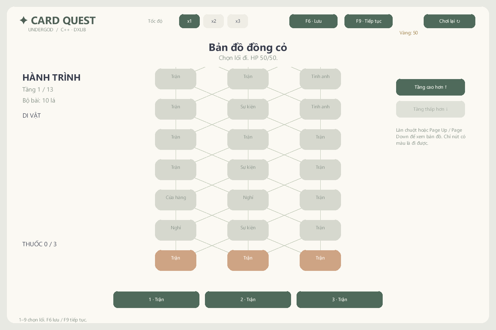

# undergod-card — v0.3

Game thẻ bài roguelike theo lượt bằng **C++17 / DxLib / Visual Studio 2022 / Windows x64**. Gà Chiến Binh đi qua một hồi phân nhánh rồi đấu Ếch Vương hai giai đoạn.

- Một hồi 13 tầng, 3 cột: trận, tinh anh, sự kiện, cửa hàng, nghỉ và trùm. Sinh từ seed, tỉ lệ nút đọc từ map.json.
- 6 địch thường, 2 tinh anh, 12 di vật, 6 thuốc và 10 sự kiện. HP/Nộ, vàng, bộ bài và đồ mang theo được giữ giữa các nút.
- 19 loại bài gốc và 19 bản nâng cấp; chọn 1/3 lá sau trận. Cửa hàng gỡ được mọi lá, chỗ nghỉ hồi HP hoặc nâng cấp một lá.
- Tự lưu sau hành động; **F6 lưu / F9 tiếp tục**, giữ cả tay bài, hiệu ứng và RNG giữa trận.
- **Sao Rơi**: phóng lao lên trời rồi rơi vào địch. x1 chậm mặc định, x2/x3 tăng tốc.
- 50 PNG pastel và UI tiếng Việt. Địch hiện dùng chung sprite ếch; bài mới dùng ký hiệu khi chưa có ảnh riêng.

## Build và chạy nhánh này

Cài Visual Studio 2022 với bộ công cụ C++ cho desktop, MSVC v143, Windows SDK và bộ DxLib Visual C++ x64 ở C:\DxLib. Mở [UndergodCard.sln](UndergodCard/UndergodCard.sln), chọn UndergodCard, Release | x64 và nhấn F5.

    .\UndergodCard\verify.ps1 -Configuration Release
    .\UndergodCard\verify.ps1 -Configuration Debug
    .\UndergodCard\package.ps1 -SkipBuild

Các script nhận -DxLibDir để đổi đường dẫn SDK. EXE nằm ở UndergodCard/bin/Release; ZIP ở UndergodCard/release. Bản v0.3 hiện được tiếp tục tại [PR #2](https://github.com/nqxw1kqw/undergod-card/pull/2); [Releases](https://github.com/nqxw1kqw/undergod-card/releases) vẫn là bản v0.1 trước đó.

## Điều khiển

Chuột / 1–9 chọn lối và chơi thẻ; E hết lượt, U Sao Rơi, F1/F2/F3 tốc độ, Space/Esc bỏ qua cinematic. Trong cửa hàng, E/Esc rời đi; tại chỗ nghỉ, H hồi HP hoặc 1–8 nâng cấp lá trên trang. Page Up/Page Down hoặc các nút trang/cuộn bản đồ. Z/X/C/V dùng thuốc. Mở lại tự tiếp tục save.json; R/Enter bắt đầu seed mới.

## Kiểm chứng và lộ trình

MSVC Debug/Release chạy cùng bộ logic và smoke DxLib. Bot có chế độ chạy 1.000 seed; báo cáo ghi rõ tỉ lệ thắng của bot, không coi đó là số liệu người chơi mới.

Xem [hướng dẫn native](UndergodCard/README.md), [kiểm chứng](UndergodCard/docs/VALIDATION.md), [kế hoạch gameplay](UndergodCard/docs/GAMEPLAY_PLAN.md) và [bàn giao v0.3](UndergodCard/docs/V0.3_WIP_NOTES.md).

SDK DxLib cài riêng. Repo không chứa bản web, kho RE, ảnh nguồn hay file build/cache.
