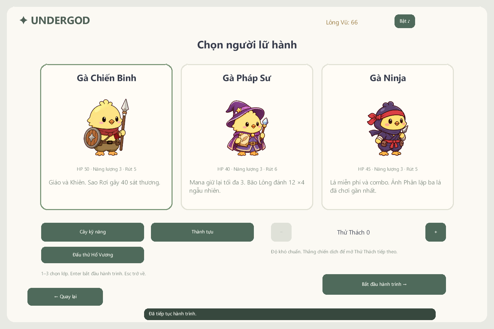

# undergod-card — v1.4.1-preview

Game thẻ bài roguelike bằng **C++17 / DxLib / Visual Studio 2022 / Windows x64**. Nhánh `integrate/draft-main-optimizations` lấy draft làm nền và tích hợp các cải tiến đã triển khai trên main. Giữ chiến dịch, [ba Turn Star](UndergodCard/docs/TURN_STARS.md), avatar map, chuyển cảnh đen, FIGHT và [36 lá riêng của sáu boss](UndergodCard/docs/BOSS_DECKS.md). Đối chiếu từng mục tại [báo cáo hợp nhất](UndergodCard/docs/DRAFT_MAIN_INTEGRATION.md).

Khung hình/cửa sổ **1600×900 (16:9)**; giữ [hoạt ảnh riêng theo kỹ năng](UndergodCard/docs/SKILL_ANIMATIONS.md) và toàn bộ asset draft. Bản tích hợp thêm chuyển động bài có ID riêng, xem trước hiệu quả thực, popup chặn/HP riêng, FX nhẹ, fade kết thúc/recap, xem chồng bài không lộ thứ tự, chơi lại cùng seed và ba mức khó đấu thử.

Mốc mới thêm [bảng dự báo/diễn biến sáu nhịp](UndergodCard/docs/SIX_ACTION_POLISH.md), đánh dấu đúng lá xuyên phần hồi động tác, nhịp heavy/khiên/hồi riêng và cache dự báo theo trạng thái combat. T/nút dự báo mở bảng; các phép đo CPU và kiểm tra renderer được ghi riêng, không suy thành mức tăng FPS.

- Ba hồi 13 / 13 / 15 tầng, map phân nhánh theo seed; sáu boss có cơ chế riêng.
- Xếp ba lá rồi Attack: ta 1 → địch 1 → ta 2 → địch 2 → ta 3 → địch 3. Kế hoạch địch hiện sẵn và có tooltip.
- 50 lá gốc và 48 bản nâng cấp: Tiêu hao, Giữ giáp, Xuyên giáp, năng lực, hồi sinh, lời nguyền.
- 12 sự kiện thực, shop, nghỉ, 17 di vật và sáu thuốc.
- Chiến Binh, Pháp Sư, Ninja; 45 kỹ năng, Lông Vũ lưu giữa run, Thử Thách 1–10 và 15 thành tựu.
- Mỗi boss có bộ sáu lá riêng, chọn theo pha HP; ảnh/tên/chiêu riêng, không vào shop hoặc thưởng người chơi.
- 379 PNG pastel, gồm 36 icon bài boss và chữ FIGHT nền trong suốt; nhạc ba hồi/chín cue, cinematic ba tuyệt kỹ.
- Lưu/tải cả chiến dịch, ba RNG, triệu hồi, năng lực và lịch sử bài; profile riêng.

## Chạy và build

Tải gói Windows tại [Releases](https://github.com/nqxw1kqw/undergod-card/releases), giải nén rồi chạy UndergodCard.exe. Giữ assets, data và licenses cạnh EXE. Gói chơi không cần cài Visual Studio hay SDK.

Để sửa code, mở [UndergodCard.sln](UndergodCard/UndergodCard.sln) bằng VS2022, chọn UndergodCard, Release | x64. Cần bộ công cụ C++ cho desktop, MSVC v143, Windows SDK và DxLib Visual C++ x64 (mặc định C:\DxLib).

    .\UndergodCard\verify.ps1 -Configuration Release
    .\UndergodCard\verify.ps1 -Configuration Debug
    .\UndergodCard\bin\Release\CoreChecks.exe --simulate-stars 300
    .\UndergodCard\bin\Release\CoreChecks.exe --integrate-balance 20
    .\UndergodCard\package.ps1 -SkipBuild

Các script nhận -DxLibDir. Nhánh tích hợp mới giữ cả lịch sử main/draft; hai nhánh nguồn và [PR draft cũ #2](https://github.com/nqxw1kqw/undergod-card/pull/2) giữ nguyên. ZIP build của nhánh này ở `UndergodCard/release/`; trang Releases có thể vẫn là phiên bản trước.

## Điều khiển và tiến trình

Chuột / 1–0 xếp bài; ←/→ xem chi tiết, Space xếp lá đang focus; bấm hàng chờ để gỡ. Đủ ba vị trí thì Attack/E, ta/địch luân phiên. P/O xem chồng rút/bỏ, Esc đóng. N hành trình mới, Shift+R lặp seed hiện tại, R/Enter mở menu lớp; D đổi mức khó khi đấu thử. Tab chọn mục tiêu, U tuyệt kỹ; F1/F2/F3 đổi tốc độ, Space/Esc bỏ cinematic; Z/X/C/V dùng thuốc, F10 âm thanh, nút FX đổi mức hiệu ứng. F6 lưu/F9 tải; bánh xe/Page Up/Page Down đổi trang.

profile.json giữ Lông Vũ/kỹ năng/thành tựu; save.json giữ hành trình. Chép cả hai khi chuyển máy. Schema session v2 không tương thích v1 cũ; khi tự mở, game giữ tệp cũ thành .invalid.* trước khi tạo mới.

## Kiểm chứng

Xem [VALIDATION](UndergodCard/docs/VALIDATION.md), [hướng dẫn native](UndergodCard/README.md), [COMPLETION](UndergodCard/docs/COMPLETION.md) và [checklist](UndergodCard/docs/IMPLEMENTATION_CHECKLIST.md).

Mục tiêu 25–35 phút/run và tỉ lệ thắng người chơi mới 40–50% còn cần đo bằng chơi thực. Smoke DxLib kiểm tra renderer và handler UI; không thay kiểm thử nhập liệu chuột/phím Windows.

Repo giữ nguồn native và asset runtime; kho RE, bản web, ảnh nguồn, save, SDK, cache và file build ở ngoài Git.
