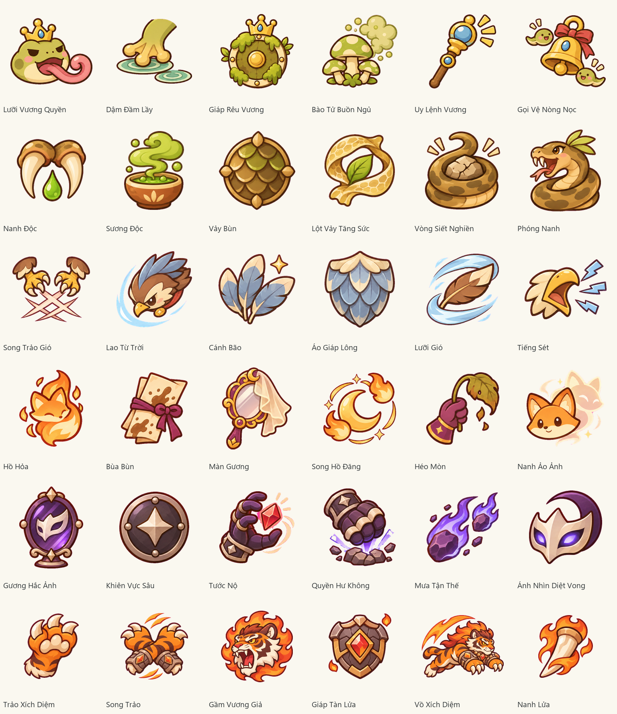

# Bộ bài riêng của boss — v1.2.0-preview

Mỗi boss có **sáu lá riêng**, tổng cộng **36 lá**, định nghĩa ở `data/boss_cards.json`. Chúng có ID, tên, ảnh và hành động riêng; không nằm trong 50 lá người chơi, shop hoặc phần thưởng. Hàng ba sao và thứ tự ta/địch vẫn giữ nguyên.

| Boss | Sáu lá |
| --- | --- |
| Ếch Vương | Lưỡi Vương Quyền, Dậm Đầm Lầy, Giáp Rêu Vương, Bào Tử Buồn Ngủ, Uy Lệnh Vương, Gọi Vệ Nòng Nọc |
| Rắn Bùn Mẹ | Nanh Độc, Sương Độc, Vảy Bùn, Lột Vảy Tăng Sức, Vòng Siết Nghiền, Phóng Nanh |
| Diều Hâu Bão | Song Trảo Gió, Lao Từ Trời, Cánh Bão, Áo Giáp Lông, Lưỡi Gió, Tiếng Sét |
| Cáo Thầy Phù | Hồ Hỏa, Bùa Bùn, Màn Gương, Song Hồ Đăng, Héo Mòn, Nanh Ảo Ảnh |
| Undergod | Gương Hắc Ảnh, Khiên Vực Sâu, Tước Nộ, Quyền Hư Không, Mưa Tận Thế, Ánh Nhìn Diệt Vong |
| Hổ Vương | Trảo Xích Diệm, Song Trảo, Gầm Vương Giả, Giáp Tàn Lửa, Vồ Xích Diệm, Nanh Lửa |

## Chọn và thực hiện

Đầu vòng, boss chọn theo trọng số từ những lá được phép ở pha HP hiện tại. Ba vị trí được chốt và công bố trước khi người chơi chọn bài. Các lá thường trong cùng kế hoạch không trùng nhau khi còn lựa chọn hợp lệ. Đây là bộ chọn bài theo trọng số mỗi vòng, không có chồng rút/bỏ hữu hạn riêng cho boss.

Lá đầu tuân thủ mở đầu tấn công và giới hạn lượt thủ của boss. Các lá phụ không tự khởi động tụ lực. Nếu lá đầu là tụ lực, hai lá phụ dùng **lá giáp riêng của đúng boss**, mỗi lá cho 3 giáp; trường hợp này được phép lặp lá giáp. Địch có viện binh vẫn dùng chung tổng ba sao; Nòng Nọc/ảo ảnh dùng hành động của chính đơn vị đó.

Hổ mở pha Bùng Lửa bằng Vồ Xích Diệm, báo trước một vòng rồi mới gây sát thương. Sau cú vồ, kế hoạch tiếp theo lại được chọn từ bộ riêng, nên có thể chuyển sang song trảo, gầm, giáp hoặc nanh lửa. Không còn bắt buộc lặp một chu kỳ tụ lực mãi như bộ pattern cũ. Rắn chỉ mở Vòng Siết Nghiền ở pha cuối.

Uy Lệnh/Gọi Vệ của Ếch, Lột Vảy/Phóng Nanh của Rắn, Nanh Ảo Ảnh của Cáo và các lá Tước Nộ/Quyền Hư Không/Mưa Tận Thế của Undergod mở theo `minPhase`. Chuyển pha giữa một chuỗi không thay các lá đã công bố. Gương Hắc Ảnh sao chép hiệu ứng bài người chơi nhưng giữ ảnh và ID riêng của Undergod; tooltip ghi rõ lá được sao chép.

Mức sát thương thường 35%, trạng thái làm tròn một nửa và các luật tài nguyên tiếp tục theo [TURN_STARS](TURN_STARS.md). Tooltip được tạo từ hành động đã chốt và trạng thái hiện tại, cùng hành động dùng khi chạm. Rê chuột, chọn/gỡ bài và lưu/tải không đổi kế hoạch hoặc RNG.

## Sửa icon trên map

Trước đây, khi rời trạng thái Travel để bắt đầu FadeOut, renderer đọc lại `run.node` cũ trong khi điểm mới chưa được xác nhận. Icon vì vậy nhảy ngược về đầu đường. Renderer nay dùng cùng một vị trí đích trong cả Travel và FadeOut; lúc màn đen hoàn toàn mới bàn giao sang `run.node` mới. Trở lại map sau thưởng và tải bản lưu đều giữ điểm vừa đến. Vào hồi mới vẫn bắt đầu ở lối vào bản đồ mới.

## Ảnh và lưu game

36 PNG RGBA8 256×256 ở `assets/pastel/boss_cards`. Sáu atlas nguồn 2 hàng × 3 cột do **ImageGen tích hợp** tạo theo sprite và icon hiện có; bộ xử lý `generate2dsprite.py` tách nền magenta, căn giữa/cùng tỉ lệ và kiểm tra mép. Không vẽ hình bằng code, không thay sprite boss cũ. Tổng runtime là **239 PNG và 12 WAV**.

Prompt đầy đủ, tên/hash nguồn và thứ tự xuất từng lá ở `assets/provenance.json`, mục `boss_card_decks`. Công cụ nhập lại là `tools/import_boss_cards.py`; raw, prompt và metadata QC làm việc ở `artifacts/boss-cards`, không cần khi chạy game.

Session v2 giữ thêm `deck_card_id` tùy chọn trong intent. Bản v1.1 chưa có trường này vẫn giữ giá trị hành động, thứ tự, mục tiêu và RNG đã công bố; game gắn ảnh riêng tương ứng mà không rút lại bài. Bản lưu có ID của boss khác hoặc ID không tồn tại bị từ chối trước khi thay trạng thái hiện tại.

Kiểm tra trong `tests/boss_deck_checks.cpp` bao gồm tọa độ xuyên FadeOut, trở lại map/lưu/tải, quyền sở hữu ở mọi pha, từng hành động trong 36 lá, tụ lực hai vòng, ảnh Sao Chép và từ chối ID chéo boss. `--star-smoke` ghi vị trí avatar thực từ renderer và chụp sáu boss cùng tooltip; số liệu cuối ở [VALIDATION](VALIDATION.md).
