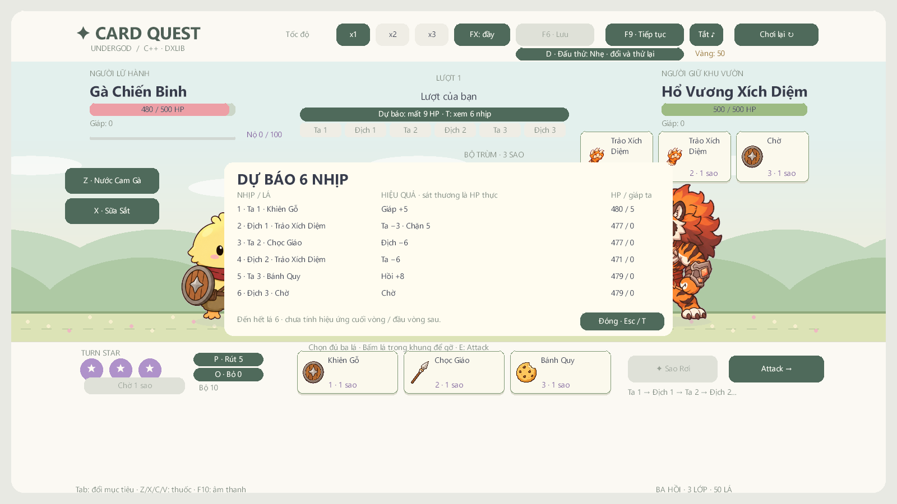
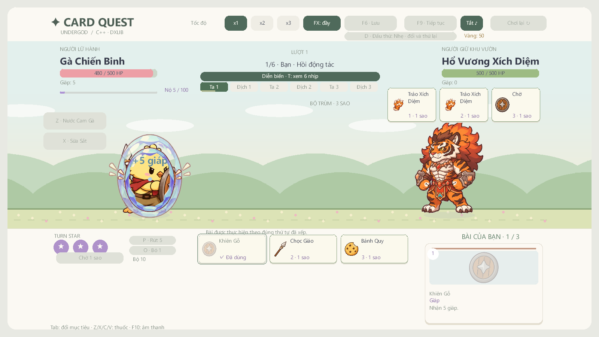

# Nhịp sáu lá và hiệu năng dự báo — v1.4.1-preview

Tiếp tục trên `integrate/draft-main-optimizations`, sau mốc hợp nhất `f8f17e8`. Giữ C++17/DxLib, 1600×900, luật ba sao, chiến dịch, chỉ số bài và toàn bộ asset.

## Người chơi thấy gì

- Thanh sáu nhịp nằm giữa HUD: Ta1/Địch1/Ta2/Địch2/Ta3/Địch3. Chip, viền ô bài và thanh tiến độ bám hành động đang diễn, kể cả phần hồi sau contact; không nhảy sang lá tiếp khi core vừa tăng cursor.
- Bấm nút dự báo hoặc **T** để xem từng lá: mất HP thực, giáp chặn, hồi máu và HP/giáp của người chơi sau nhịp đó. Ô chưa chọn được mô phỏng như Chờ. Đóng bằng T/Esc/nút Đóng trước khi sửa hàng hoặc đánh.
- Khi đang đánh, bảng chuyển sang diễn biến; dấu ✓ là contact đã xảy ra. Các dòng còn lại vẫn là dự báo. Có thể đổi tốc độ/âm thanh/FX khi bảng mở.
- Dự báo chỉ tính đến hết hành động thứ sáu, **chưa bao gồm hiệu ứng cuối vòng/đầu vòng tiếp**. Khi đòn sớm kết liễu trận, các dòng còn lại báo hủy. Không hiển thị thứ tự rút của chồng bài.
- Chi tiết một lá khi rê chuột vẫn có nghĩa “nếu dùng ngay”; bảng sáu nhịp mới phản ánh tác động của các lá đứng trước nó.

## Nhịp động tác

Đòn thường giữ contact 0,32 giây logic. Đòn nặng có launch 0,12/contact 0,44/end 0,88; đủ khoảng lấy đà trước khi đâm. Họ khiên mặc định giảm thời lượng 0,85 →0,62, họ hồi mặc định 0,95 →0,70; các profile có override riêng vẫn giữ cấu hình riêng. Không đổi lượng sát thương hoặc luật giải quyết hiệu ứng.

Âm thanh contact tiếp tục phát từ damage event, vì vậy cũng dời cùng va chạm đòn nặng. Test kiểm tra trước contact không có damage/hit cue, sau contact đúng một lần ở x1/x2/x3. Smoke cũ từng gắn cứng contact 0,32 cho heavy được sửa để dùng timing thật; giữ kiểm tra cả trước và sau chạm.

## Cách tính và lưu kết quả

`game_forecast.cpp` tách việc mô phỏng/ghi nhận sáu hành động khỏi renderer. Core thật và dự báo dùng cùng `ResolveStarAction`; kết quả dự báo chỉ được áp lên bản sao. Khi đánh thật, mỗi contact ghi lại HP/giáp/effect thực vào trace riêng.

Cache dùng khóa byte chính xác của trạng thái combat, **không dùng hash có khả năng trùng**. Khóa chứa fighter/status, hàng bài và mục tiêu từng lá, intent, pile theo thứ tự, ba RNG, combat mods và trạng thái nội bộ của resolver. Tạo khóa không cấp phát snapshot/JSON hoặc copy Config; bộ đệm string tái sử dụng dung lượng.

Một khóa mới làm mất hiệu lực kết quả vòng và các preview lá. Nhiều frame không đổi trạng thái dùng lại kết quả; đổi tốc độ/FX/thời gian hình ảnh không buộc mô phỏng lại. Bài trùng tên vẫn có chỉ số/queue riêng trong khóa. Lý do lá không dùng được được cập nhật theo trạng thái điều khiển hiện tại, không đóng băng theo cache.

Catalog/định nghĩa encounter được xem là cố định giữa các lần reset/load. Nếu thêm tính năng sửa nội dung trực tiếp khi đang chạy, phải gọi `InvalidateForecast()` sau sửa catalog. Thêm field gameplay mới cũng phải cập nhật `AppendForecastKey`; kiểm thử cache cần thêm tình huống tương ứng. Cache/trace chỉ là trình diễn, không thêm trường vào save/profile.

## Đo và kiểm tra

`CoreChecks --forecast-benchmark 1000` so cách cũ (copy combat và resolve sáu action mỗi lần hỏi HP) với cách dùng cache trên cùng một tình huống ba lá, xen kẽ 15 block ×1.000 lần. Checksum và snapshot/RNG được đối chiếu. Đây là **CPU của riêng truy vấn dự báo**, không phải FPS tổng thể hoặc GPU.

Loạt đo Release ở máy hiện tại: median cách cũ **61,6358 µs/lần**, cache **0,9702 µs/lần**; p95 của block tương ứng 72,4959 và 1,5802 µs/lần. Cache chỉ build một lần sau warm-up. [Dữ liệu máy đọc](reports/forecast-performance.json).

Integration smoke đo thêm 120 frame cho từng trường hợp: chuẩn bị, focus chi tiết và mở bảng sáu nhịp. Tách CPU Update/Draw khỏi ScreenFlip; phần present có cả đợi GPU/màn hình, không coi nó là CPU thuần. Kiểm tra cả 120 frame không dựng lại dự báo. [Đo renderer Release](reports/native-performance-release.json).

Test mới kiểm tra thay đổi HP/giáp/tay/intent/runtime/pile, không đổi RNG, modal, hủy sau lethal, trace sau mỗi contact và nhịp heavy ở ba tốc độ. 300 hành trình chạy lại giữ 133 thắng/167 thua/0 kẹt. Ảnh và kết quả Debug/Release/EXE giải nén ở [VALIDATION.md](VALIDATION.md). Chưa xác nhận bằng chơi tay toàn chiến dịch hoặc benchmark trên máy sạch.

