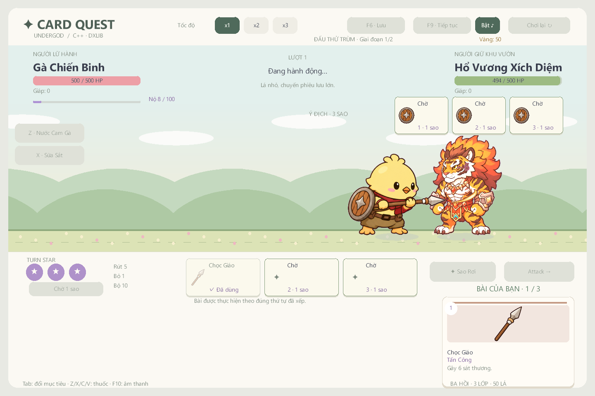
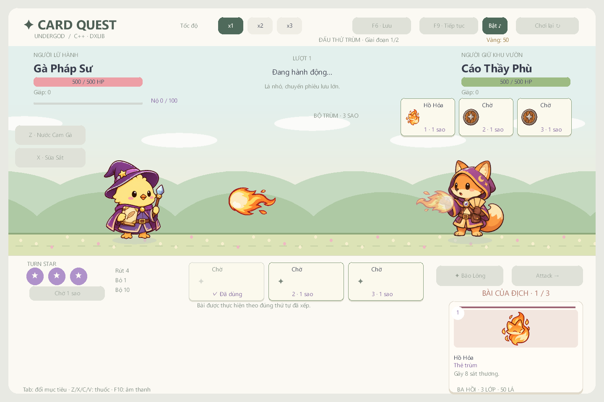
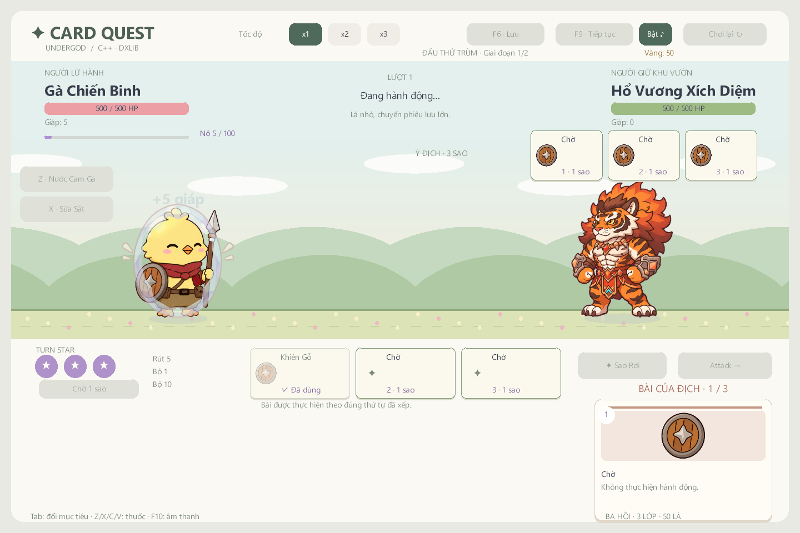
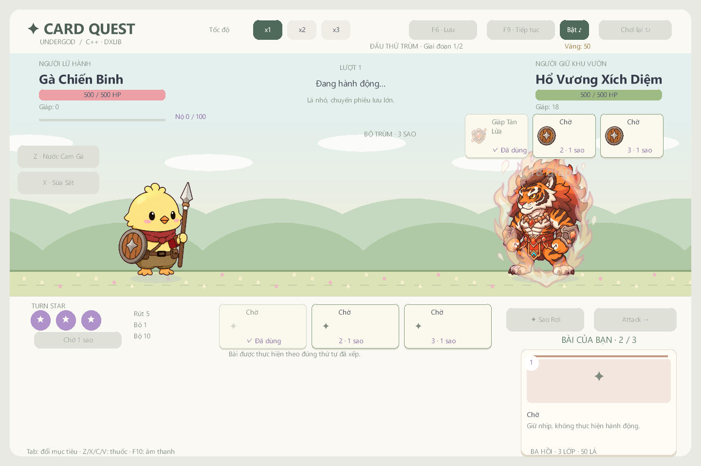

# Hoạt ảnh theo kỹ năng — v1.3.0-preview

Player và sáu boss dùng động tác cơ thể, đường bay, vật phẩm và hiệu ứng chạm theo từng lá. Có 98 cấu hình: 50 lá gốc, 36 lá boss, 11 hành động địch thường và Chờ. 48 lá chơi được có cấu hình riêng; hai lời nguyền không chơi được dùng Chờ. Bản nâng cấp dùng cùng kỹ năng với hiệu ứng lớn hơn.

| Nhóm | Hình ảnh và chuyển động |
| --- | --- |
| Chọc Giáo, Trọng Kích | Gà đưa lao ngang, tiến sát mục tiêu, đâm ở thời điểm chạm rồi thu về |
| Mổ, Mổ Liên Hoàn, Giậm Chân | Cúi mổ; nhiều vệt chạm; nhảy giậm và sóng chạy trên mặt đất |
| Pháp Sư | Niệm phép tại chỗ, cầu phép/độc bay từ tay tới địch; không dùng cú lao cận chiến |
| Lao ném | Bay thẳng, vòng cung, tỏa hai lao, quay về hoặc mang lửa theo đúng lá |
| Mưa Sao Băng, Mưa Lông, Mưa Đao | Nhiều vật thể từ trên rơi xuống; mục tiêu ngẫu nhiên được dự đoán bằng bản sao RNG |
| Ninja | Chém, ném đao, lướt bóng, khói và đao quay quanh người |
| Hồi phục, buff | Vật phẩm đúng lá, dấu phép hoặc ánh hồi phục quanh người dùng |
| Khiên | Tư thế đỡ; vòng bảo vệ xanh/lá/bóng/lửa giữ khi giáp còn lớn hơn 0, lóe khi chặn và tan khi hết giáp |
| Ếch / Rắn | Lưỡi kéo từ miệng rồi rút về; giậm, bào tử, phun độc, lột da, vòng bảo vệ lá |
| Diều Hâu / Cáo | Sà/vỗ cánh, lông bay, tia sét; cầu lửa, bùa bay, hỏa linh xoắn và bóng lướt |
| Undergod / Hổ | Sao chép đúng hoạt ảnh lá đã lấy, hút ngược, mưa hắc tinh; vuốt, gầm, khiên lửa, tụ lực và vồ |

Ba tuyệt kỹ giữ cinematic riêng. Sao Rơi vẫn phóng lao lên trời rồi rơi xuống boss.

## Thời gian và thứ tự

Mỗi lá có `launch` (phóng), `contact` (chạm) và `duration` (hết động tác), tính theo giây trên đồng hồ game. Core chỉ thực hiện lá một lần ở `contact`. Đạn tồn tại trong khoảng phóng → chạm; ảnh va chạm và phản ứng nhận đòn xuất hiện từ chạm → hết. Vật thể quay về có thêm đường rút, giáp được vẽ từ số giáp thật.

Luật ba sao vẫn luân phiên ta 1 → địch 1 → ta 2 → địch 2 → ta 3 → địch 3. Lá đang thi triển được đặt ở góc dưới bên phải để không che đường đạn. Trận thắng hoặc trận nối tiếp chỉ chuyển màn sau phần cuối của hoạt ảnh hoặc cinematic.

Các hit của cùng một lá vẫn được core giải quyết cùng một lần, theo thứ tự hiệu ứng gốc. Không thêm lần gieo RNG hay thay sát thương để phục vụ hình ảnh. X1/X2/X3 nhân cùng đồng hồ của cơ thể, đường bay, phản ứng và khiên. Mô phỏng 300 seed giữ kết quả 133 thắng / 167 thua / 0 kẹt như v1.2.0.

## Nguồn và chỉnh sửa

- `data/skill_animations.json`: cấu hình từng lá, các nhóm mặc định, tên effect, tư thế và điểm phóng của từng cơ thể. Thiếu cấu hình là lỗi tải dữ liệu, không âm thầm dùng một cú đánh chung.
- `src/game_skill.cpp`: lựa chọn tư thế, dự đoán mục tiêu không đổi RNG thật, đường bay và phản ứng cục bộ cho từng đơn vị.
- `src/ui_skill.cpp`: vẽ cơ thể, đạn, ảnh chạm và khiên. Điểm kết nối lưỡi dùng biên alpha đã xuất trong manifest.
- `assets/pastel/characters`: 72 frame mới cho 18 động tác. `assets/pastel/skill_fx`: 68 frame mới cho 17 hiệu ứng. Mỗi bộ có bốn ảnh khác nhau, không nhân bản một ảnh thành animation.
- `assets/provenance.json` → `skill_animations`: đủ 35 prompt thực tế, ảnh tham chiếu, hash nguồn, danh sách xuất, tỉ lệ cơ thể và QC. Tất cả bitmap mới do ImageGen tạo.
- `tools/import_skill_art.py`: chỉ tách grid, loại nền magenta/viền màu, căn chân y=456, chuẩn hóa cùng tỉ lệ và tạo manifest. Không vẽ thêm nội dung bằng script. Raw/prompt/QC/GIF ở `artifacts/skill-art`, nằm ngoài Git; ảnh runtime và provenance được lưu trong Git.

Runtime có 379 PNG và 12 WAV. Toàn bộ 239 PNG đã duyệt trước mốc này giữ nguyên hash. Demo HTML độc lập giữ nguyên 220 tệp runtime và bản một tệp.

## Kiểm chứng

`CoreChecks` kiểm tra thời điểm sát thương, đạn có dịch chuyển trước khi chạm, tư thế thật, khiên sau lá và lúc vỡ, Sao Chép, mục tiêu ngẫu nhiên, hoãn thưởng sau đòn kết liễu và kết quả x1/x2/x3.

`UndergodCard.exe --animation-smoke` dùng renderer DxLib thật, nạp đủ 379 ảnh, chụp 24 mốc của lao/phép/khiên/mưa sao/lưỡi/vồ, đi qua binding của 48 lá player và 36 lá boss. Cùng với hai smoke cũ, chạy trên Debug, Release và EXE giải nén từ ZIP. Báo cáo tại [VALIDATION.md](VALIDATION.md).

Smoke gọi handler UI và renderer; chưa thay cho chơi tay một hành trình trên máy Windows khác.
