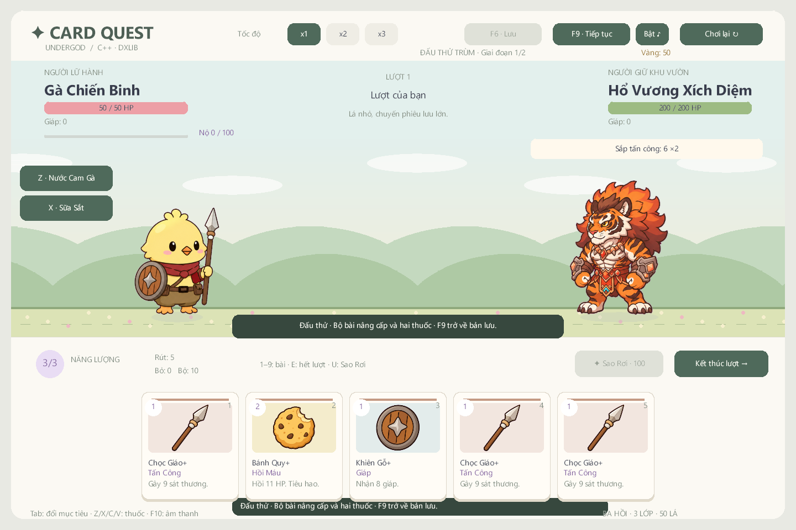

# Hổ Vương Xích Diệm

Boss thứ sáu, bổ sung theo ảnh hổ chiến binh Shin gửi. Có thể gặp ở cuối Hồi 2, cùng pool với Rắn Bùn Mẹ và Diều Hâu Bão.

## Cơ chế

- 200 HP, hai pha, không hồi lại HP khi chuyển pha.
- Pha 1: đấm 10–13; song trảo 4–6 ×2; gầm nhận 6 giáp và 2 Sức Mạnh.
- Dưới 50% HP: Bùng Lửa, nhận thêm 2 Sức Mạnh, bắt đầu tích tụ hai lượt.
- Pha 2: cú vồ 25–28 sát thương gốc, cộng Sức Mạnh/trạng thái; có một lượt chờ và một lượt tung đòn. UI báo sát thương thực sau hệ số. Sau đòn vồ lại có nhịp tụ lực mới.
- Độc, Suy Yếu, Dễ Vỡ và giáp vẫn tác động theo luật chung. Không thêm thanh HP ẩn hoặc miễn sát thương.

## Chơi thử ngay

Ở màn chọn lớp, bấm **Đấu thử Hổ Vương**. Chế độ thử cấp bộ khởi đầu đã nâng cấp và hai thuốc để kiểm tra boss Hồi 2. Có thể đổi lớp rồi đấu lại; nút Bắt đầu hành trình vẫn mở chiến dịch bình thường.

Hoặc chạy:

    UndergodCard.exe --boss tiger --seed 1337

Đấu thử không ghi đè save.json/profile.json, không mua kỹ năng hoặc lưu các thay đổi tùy chọn từ chế độ thử, không thưởng Lông Vũ/thành tựu và không tăng bộ đếm run. F9 tải lại hành trình đã lưu nếu có. Các bản lưu Hồi 2 cũ giữ boss Rắn/Diều Hâu hợp lệ sau khi thêm hổ vào pool.

## Sprite và nguồn

12 PNG RGBA 512×512, bốn frame cho mỗi action:

- assets/pastel/characters/char_tiger_idle_0.png tới idle_3.png.
- assets/pastel/characters/char_tiger_attack_0.png tới attack_3.png.
- assets/pastel/characters/char_tiger_ult_charge_0.png tới ult_charge_3.png.

Đã giữ sọc hổ, mặt trắng, mắt vàng, tóc tối, bờm lửa cam/đỏ, giáp bạc và chi tiết xanh ngọc từ mẫu gốc. Góc ba phần tư quay trái để đối diện gà. Boss hiển thị lớn hơn nhân vật chính; chân neo y=456.

Raw do **ImageGen tích hợp** tạo, riêng từng action trên grid 2×2 nền magenta. Chỉ hậu xử lý alpha, tách frame, căn chân và chuẩn hóa body. Body đo được 351–378 px theo pose; không frame nào chạm biên cell. Các sprite cũ giữ nguyên.

Prompt đầy đủ, tên/hash ảnh sinh và danh sách đầu ra nằm trong [assets/provenance.json](../assets/provenance.json), các nhóm tiger_idle, tiger_attack và tiger_ult_charge. Raw/QC nằm ngoài Git trong artifacts/art-v1.

## Kiểm tra

tests/tiger_checks.cpp kiểm tra pool boss theo seed, HP/ngưỡng pha, gầm, nhiều hit, charge/giáp, snapshot, thành tựu sáu boss, bảo toàn save/profile khi đấu thử và tải bản lưu Hồi 2 trước khi thêm hổ. Smoke DxLib có ảnh idle/đánh/gầm và xác nhận damage đúng nhịp. Kết quả chung tại [VALIDATION.md](VALIDATION.md).
