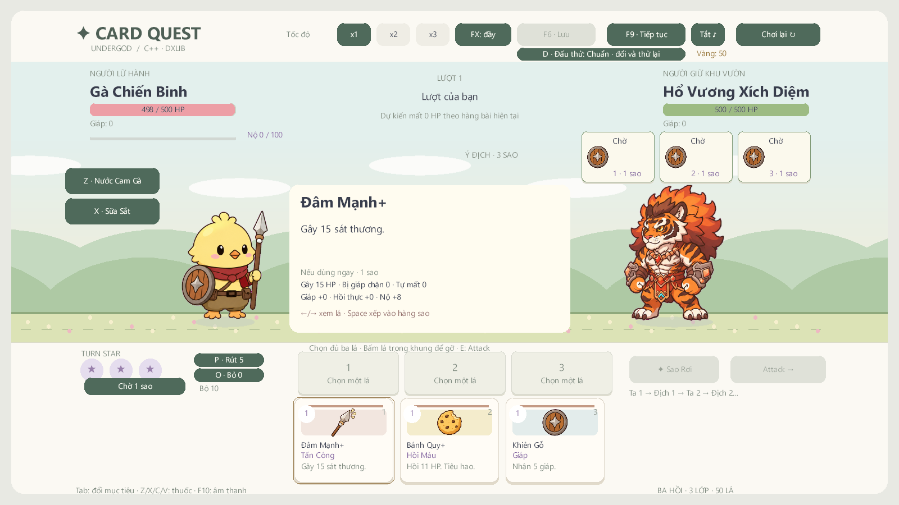
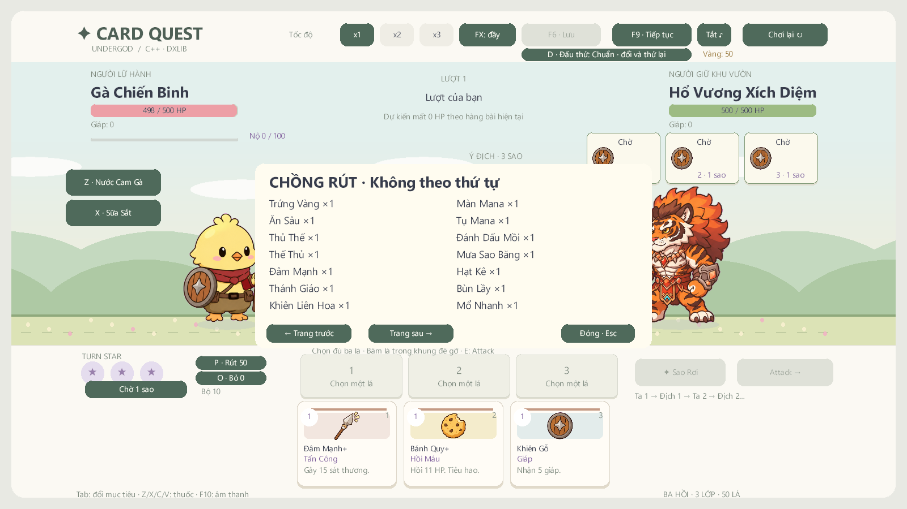
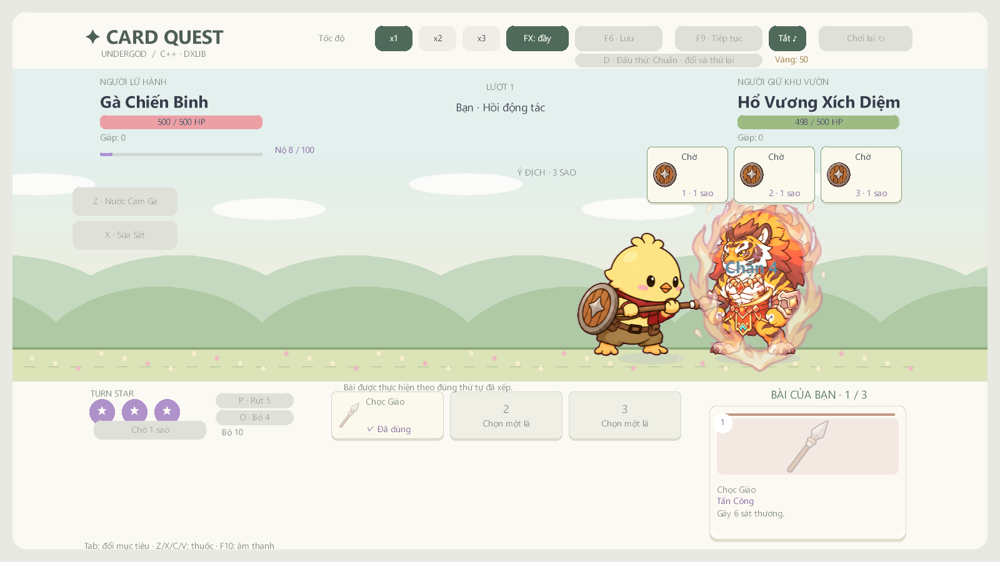
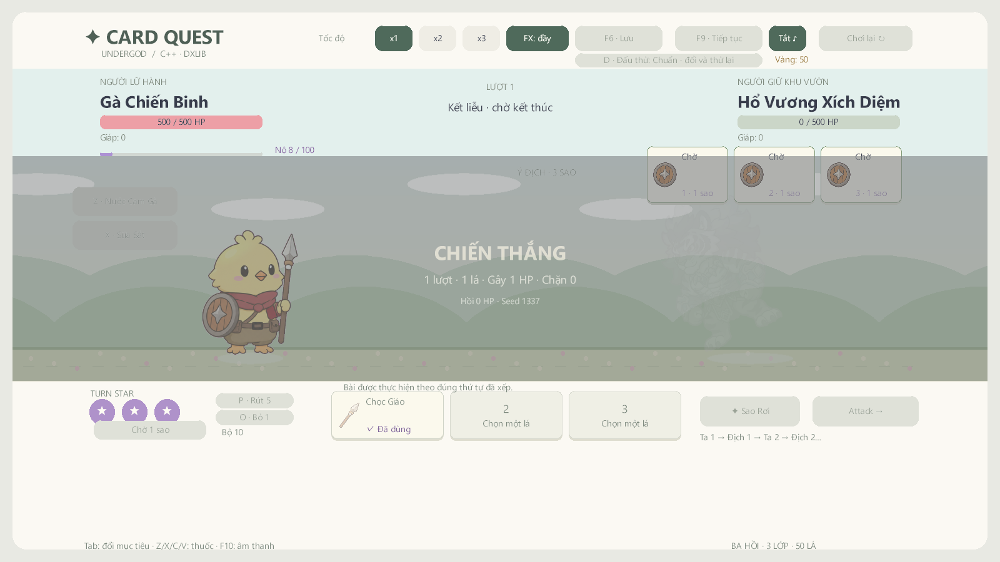
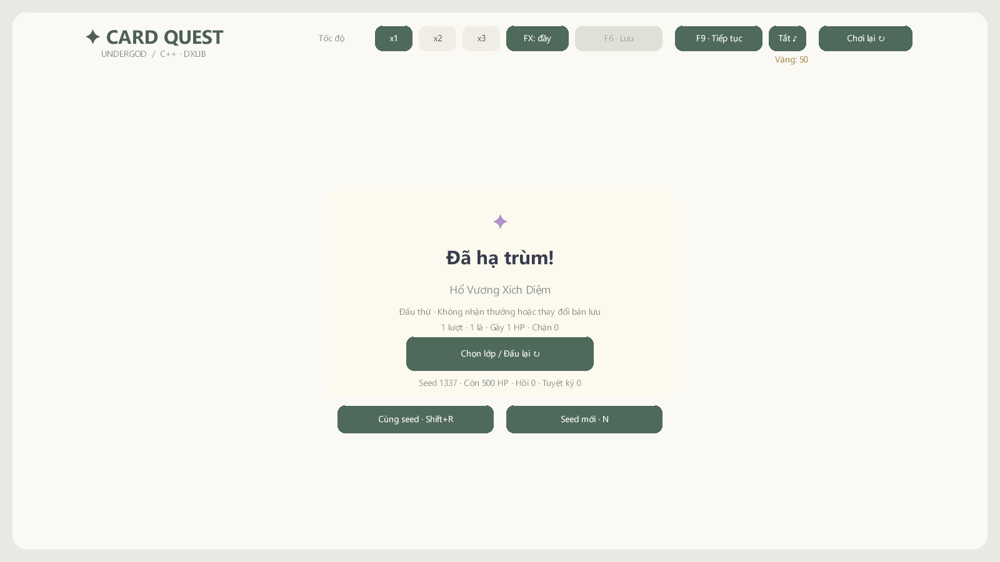

# Kiểm chứng — 2026-11-09

**v1.4.0-preview**, nhánh `integrate/draft-main-optimizations`, C++17 / DxLib / MSVC v143 / Visual Studio 2022 / Windows x64. Draft `65b383b` là nền; main `2a70e02` cung cấp các cải tiến được chuyển sang luật Turn Star. Xem [đối chiếu từng phần](DRAFT_MAIN_INTEGRATION.md). Hai nhánh nguồn giữ nguyên.

| Kiểm tra | Kết quả mới chạy |
| --- | --- |
| Build Debug / Release x64 | Thành công; chỉ còn cảnh báo C4010 trong SDK DxLib |
| Core Debug / Release | **4.077 kiểm tra/cấu hình, 0 lỗi** |
| Release với 300 hành trình | **4.078 kiểm tra, 0 lỗi**; 133 thắng /167 thua /0 kẹt, giữ nguyên baseline draft |
| Sáu boss ×ba lớp ×ba mức khó ×ba chính sách ×20 seed | **3.240 trận +3.240 replay**, so trace/snapshot/RNG và bảo toàn đa tập bài; 383.937 kiểm tra, 0 lỗi/0 kẹt |
| Bốn smoke DxLib trên Debug / Release | Legacy, Turn Star, skill animation, integration đều thoát 0 và PASS=1 |
| EXE từ ZIP giải nén riêng | Cả bốn smoke thoát 0, PASS=1 |
| Renderer | Backbuffer/client 1600×900; 18 ảnh integration, 24 mốc skill; bộ lọc đơn sắc DxLib chạy thành công cho ba hero/sáu boss |
| Runtime | 379 PNG/12 WAV giữ nguyên hash so với draft; 18 JSON, chỉ cinematic đổi cue zoom |
| ZIP | 417 tệp; CRC, danh sách chính xác, hash toàn bộ runtime và EXE khớp nguồn |

Báo cáo máy đọc và 80 SHA-256 nguồn chuẩn hóa LF: [validation.json](reports/validation.json). Log build/core/renderer: [Debug](reports/integrate-verify-debug.txt), [Release](reports/integrate-verify-release.txt). Mốc trước được lưu ở [v1.3.1](reports/v1.3.1-validation.md) và [v1.3.0](reports/v1.3.0-validation.md).

## Hành vi mới và ảnh thực

Test kiểm tra ID hình ảnh của hai bản bài trùng tên, queue/unqueue/reflow, chuyển bài sang ô thi triển rồi bỏ/tiêu hao sau contact, vùng bấm theo vị trí đang vẽ. Giữ timing riêng từng skill, projectile và lớp khiên của draft. Bài vòng mới chỉ xuất hiện sau chuỗi sáu hành động và hồi động tác; forecast ẩn khi busy.

Preview chạy resolver trên bản sao: HP thực/giáp bị chặn/hồi bị giới hạn/Nộ bị giới hạn, lý do khóa lá; không đổi combat hoặc ba RNG. P/O chỉ hiện tên/số lượng, có phân trang và khóa thao tác xuyên modal. Đã xem ảnh chi tiết UTF-8 và bảng chồng bài.

Giáp chặn một phần tạo hai popup khác vị trí. RNG hình ảnh riêng; hạt/popup có giới hạn và được xóa cả ngoài cinematic. Nút FX nhẹ thay đổi camera ngay giữa cinematic, tắt rung/flash, lưu trong profile. Zoom nối từ giá trị segment trước, quay về trung tính trước khi kết thúc; test cả fine/coarse update, skip và x1/x2/x3.

Core xác định chết tại contact; controller giữ terminal 1,5 giây logic, fade kết quả từ 0,8–1,5 giây rồi settle một lần. Ảnh gục dùng hit sprite đã qua bộ lọc đơn sắc DxLib, nghiêng/mờ, giữ chân trong sân. Đã xem pose, fade, recap và nút cùng seed/seed mới. Test ultimate kết liễu bị skip hai lần không nhân đôi sát thương/thưởng/recap.

[Smoke integration Release](reports/release-integration-smoke.txt) gọi renderer và các handler click thật; [Debug](reports/debug-integration-smoke.txt) cũng qua. Hai smoke cũ giữ kiểm tra avatar đúng đích xuyên FadeOut/lưu/tải, FIGHT/chia bài, thứ tự ba sao, tooltip/bộ sáu boss, charge, menu/shop/sự kiện và hành trình tham chiếu. Skill smoke tiếp tục đi qua 98 cấu hình, 18 bộ cơ thể/17 FX; không dùng asset prototype main đè lên draft.

## Mô phỏng và mức khó

300 seed 0–299, Thử Thách 0, không mua kỹ năng meta, luân phiên ba lớp; bot chờ chuyển cảnh/hành động. **Đã chạy lại ở mốc tích hợp này**: Chiến Binh 50/100 thắng, Pháp Sư 28/100, Ninja 55/100; tổng 133/300, thua theo hồi 34/36/97, không kẹt. 90 trận Ếch/Hổ vẫn 48 thắng/42 thua/0 kẹt. [Dữ liệu hành trình](reports/turn-star-simulation.json), [log core](reports/integrate-core-release.txt).

Mức khó mới chỉ dành cho đấu thử: Nhẹ/Chuẩn/Khó thay sát thương địch −2/0/+4, giữ HP, bài, seed và RNG. Giữ cơ chế tụ lực của boss draft; không nhập chỉ số charge của prototype bốn lá. Thử Thách chiến dịch vẫn độc lập.

Mỗi hàng dưới có 360 trận (sáu boss ×ba lớp ×20 seed), cùng bộ seed cho từng chính sách:

| Mức đấu thử | Ưu tiên công: thắng/thua | Có thủ: thắng/thua | Có thủ/hồi: thắng/thua |
| --- | --- | --- | --- |
| Nhẹ | 103/257 | 130/230 | 142/218 |
| Chuẩn | 67/293 | 105/255 | 122/238 |
| Khó | 7/353 | 58/302 | 67/293 |

Mỗi trận chạy lại với cùng quyết định; mọi action kiểm tra bảo toàn bài gốc/bài được tạo, trace thứ tự tay và ba RNG. [Dữ liệu đầy đủ](reports/integrated-balance.json), [log 383.937 kiểm tra](reports/integrate-balance-release.txt). Đây là bot đơn giản dùng bài khởi đầu nâng cấp và tuyệt kỹ, không phải người chơi tối ưu; các mức đấu thử vẫn khá khó. Chỉ số `shield_budget_gap` là chênh giữa sát thương công bố và ngân sách giáp hiện tại, không chứng minh HP buộc phải mất hoặc seed không thể thắng.

## Gói Windows của nhánh tích hợp

ZIP chỉ có runtime/hướng dẫn/giấy phép, không có save/profile, SDK, test EXE hoặc PDB. Đã giải nén sang thư mục mới và chạy đủ bốn smoke.

- 417 tệp; **56.762.147 byte**; 379 PNG /12 WAV /18 JSON.
- SHA-256 ZIP: `a5f8afe2d8f041a425b24d73acdcda366a800735081cfacffaee0a4c888e621a`.
- SHA-256 EXE: `a83d9f2f29dcfa36210d761446494f25748e4ec81f50e17c4072d2cee37c8339`.
- [Báo cáo gói](reports/package-validation.json), [smoke integration từ gói](reports/packaged-integration-smoke.txt).

## Giới hạn bằng chứng

Smoke sử dụng renderer/backbuffer và handler UI Windows với fixture kiểm soát; chưa xác nhận nhập liệu chuột/phím Windows bằng chơi tay toàn chiến dịch, cảm giác x1/x2/x3 hoặc một máy Windows sạch khác. Helper Computer Use trước đó không nối được native pipe. Chưa đo thời lượng 25–35 phút/run, tỉ lệ thắng người mới 40–50% hoặc CPU/GPU/FPS trước/sau. Không suy những điều đó từ build/bot/PNG.

HTML/website ngoài phạm vi và thư mục sibling hiện không có trong workspace; không tuyên bố kiểm tra lại web. Session v2 giữ nguyên; profile v1 có thêm tùy chọn FX tương thích file cũ. Bản tích hợp giữ nhãn preview.
