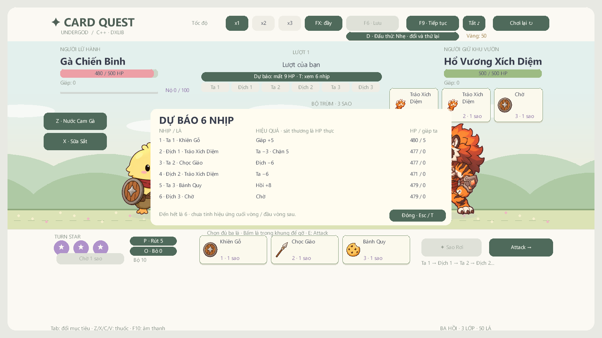
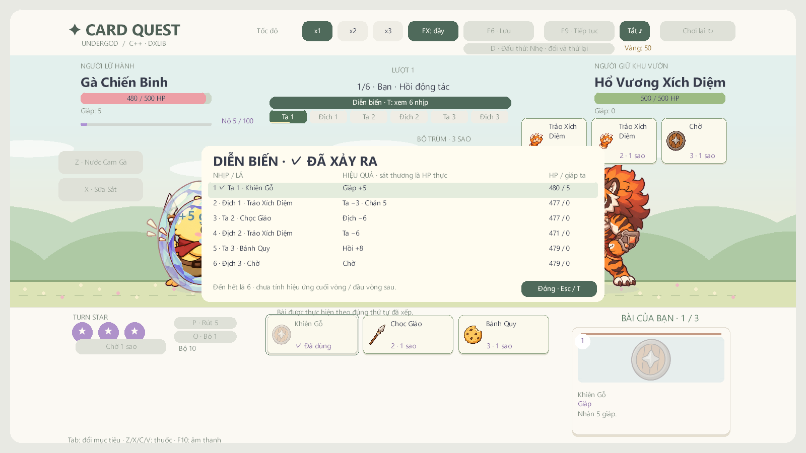
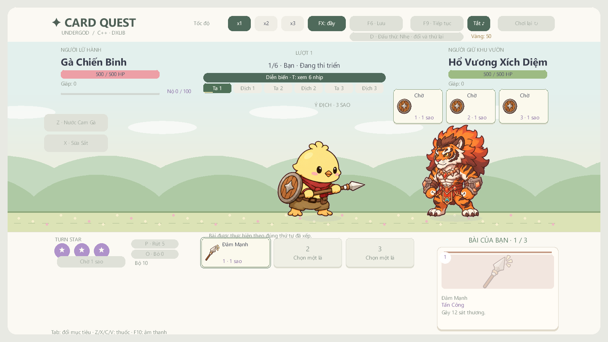

# Kiểm chứng — 2026-11-09

**v1.4.1-preview**, nhánh `integrate/draft-main-optimizations`, C++17 / DxLib / MSVC v143 / Windows x64. Tiếp tục sau mốc hợp nhất `f8f17e8`: bảng dự báo sáu hành động, trace thực tại contact, chỉ báo xuyên hồi động tác, chỉnh nhịp heavy/khiên/hồi và cache dự báo có đo CPU. [Thiết kế và điều kiện cache](SIX_ACTION_POLISH.md).

| Kiểm tra mới chạy | Kết quả |
| --- | --- |
| MSVC x64 Debug / Release | Build thành công; cảnh báo còn lại C4010 trong SDK DxLib |
| Core Debug / Release | **4.141 kiểm tra/cấu hình, 0 lỗi** |
| Release +300 hành trình | **4.142 kiểm tra, 0 lỗi**; 133 thắng/167 thua/0 kẹt, giữ baseline |
| Release +benchmark dự báo | **4.143 kiểm tra, 0 lỗi**; 15 block ×1.000 truy vấn mỗi cách, checksum/snapshot khớp |
| Sáu boss ×ba lớp ×ba mức khó ×ba chính sách ×20 seed | 3.240 trận +3.240 replay; **384.001 kiểm tra, 0 lỗi/0 kẹt** |
| Bốn smoke DxLib trên Debug / Release | Legacy, Turn Star, skill animation, integration đều thoát 0, PASS=1 |
| EXE từ ZIP giải nén riêng | Cả bốn smoke thoát 0, PASS=1 |
| Cache trong renderer | Ba tình huống ×120 frame không dựng lại dự báo |
| Trình diễn | 23 ảnh integration; đã xem bảng dự báo, trace ✓, recovery, heavy trước/sau contact |
| Runtime và gói | 379 PNG/12 WAV giữ hash; 18 JSON; 417 tệp, CRC/manifest/hash khớp |

Báo cáo máy đọc có 83 hash nguồn chuẩn hóa LF: [validation.json](reports/validation.json). Log [Debug](reports/polish-verify-debug.txt), [Release](reports/polish-verify-release.txt). Mốc trước được giữ tại [v1.4.0](reports/v1.4.0-validation.md), [v1.3.1](reports/v1.3.1-validation.md).

## Dự báo, diễn biến và timing

Test dùng cùng resolver trên bản sao để kiểm tra HP/giáp sau cả sáu contact, thay đổi thứ tự bài, giáp hấp thụ một phần, hồi giới hạn, ô trống = Chờ và hủy các nhịp còn lại khi lethal. Dự báo không đổi snapshot/ba RNG; khi thực hiện, trace ghi event và HP/giáp thật. Modal chặn bài/Attack/chờ/thuốc/đổi mục tiêu.

Thanh sáu nhịp và viền bài dùng chỉ số hành động trình diễn độc lập với core cursor: sau contact của Ta1, core cursor đã thành 1 nhưng chip vẫn Ta1 đến khi recovery xong. Bảng diễn biến đánh dấu ✓ ở các contact đã xảy ra, các dòng còn lại là dự báo. T/nút dự báo mở bảng, T/Esc/nút Đóng đóng; tốc độ/âm thanh/FX vẫn bấm được.

Heavy có launch/contact/end 0,12/0,44/0,88 giây logic; đòn thường giữ contact 0,32. Họ khiên/hồi mặc định kết thúc ở 0,62/0,70, giữ override riêng. Test x1/x2/x3 xác nhận không gây damage hoặc phát hit cue trước contact, và chỉ phát một lần tại contact. Smoke cũ đổi mốc heavy gắn cứng sang timing thực, giữ kiểm tra trước/sau.

Các kiểm tra cũ về map/avatar xuyên FadeOut, FIGHT/chia bài, sáu bộ boss, 98 binding hoạt ảnh, projectile/ward, lưu/tải/meta và skip/terminal vẫn qua. Chiến dịch và chỉ số bài không đổi; JSON duy nhất đổi so với v1.4.0 là `skill_animations.json`.

## Đo hiệu năng

[Benchmark CPU dự báo](reports/forecast-performance.json) so đúng cùng kết quả HP trên cùng tình huống ba lá, xen kẽ 15 block ×1.000 truy vấn:

| Truy vấn HP dự báo | Median µs/lần | P95 của block µs/lần |
| --- | --- | --- |
| Cách cũ: copy combat +resolve sáu action mỗi lần | 61,6358 | 72,4959 |
| Cache: so khóa trạng thái, dùng lại kết quả | 0,9702 | 1,5802 |

Khóa cache là chuỗi byte chính xác, không phải hash. Bộ đệm tái sử dụng dung lượng; key gồm các trạng thái ảnh hưởng resolver và RNG. Đổi HP/giáp/tay/plan/runtime/pile làm mất hiệu lực cache; thời gian hình ảnh, tốc độ và FX không buộc tính lại. Catalog cố định giữa reset/load; sửa catalog trực tiếp cần gọi `InvalidateForecast()`.

Đo thêm renderer thật: [Release](reports/native-performance-release.json), [Debug](reports/native-performance-debug.json), [EXE giải nén](reports/native-performance-packaged.json). Mỗi trường hợp chuẩn bị/focus/bảng sáu nhịp có 120 frame; ghi CPU Update, CPU gửi lệnh Draw, và present riêng. Present gồm cả đợi GPU/màn hình.

Đây là phép đo riêng truy vấn CPU và chi phí khung hình hiện tại, **chưa phải so FPS/GPU toàn game trước/sau**, không phải benchmark máy sạch. Không suy mức tăng FPS từ tỉ lệ thời gian truy vấn.

## Hồi quy chiến dịch và boss

300 seed 0–299, Thử Thách 0, không mua meta, luân phiên ba lớp: thắng theo lớp 50/28/55, tổng 133/300; thua theo hồi 34/36/97, không kẹt. 90 trận Ếch/Hổ giữ 48 thắng/42 thua/0 kẹt. [Dữ liệu hành trình](reports/turn-star-simulation.json), [log](reports/polish-campaign-release.txt).

Loạt sáu boss ×ba lớp ×ba mức khó ×ba chính sách ×20 seed được chạy lại với replay, trace/RNG và bảo toàn đa tập bài. Giữ nguyên số thắng/thua so với mốc hợp nhất: [dữ liệu](reports/integrated-balance.json), [log 384.001 kiểm tra](reports/polish-balance-release.txt). Bot không đại diện tỉ lệ thắng người chơi.

## Gói Windows

Gói chỉ có EXE/runtime/hướng dẫn/giấy phép, không có save/profile, SDK, CoreChecks hoặc PDB. Đã giải nén vào thư mục mới và chạy bốn smoke độc lập.

- 417 tệp; **56.777.133 byte**; 379 PNG /12 WAV /18 JSON.
- SHA-256 ZIP: `2d30757dee7404c71a779beb7ef075126a7c41167ebc88449eb506e6fb0b3597`.
- SHA-256 EXE: `ef921856fca9ca74e266de8460911f1a3fbe38a15253903682bf6d3e22210cfa`.
- [Báo cáo gói](reports/package-validation.json), [smoke integration từ gói](reports/packaged-integration-smoke.txt).

## Giới hạn bằng chứng

Đã kiểm tra renderer/backbuffer và handler UI với fixture kiểm soát. Chưa chơi tay toàn chiến dịch, xác nhận nhập liệu chuột/phím Windows trọn luồng hoặc thử trên máy Windows sạch khác. Computer Use khởi tạo/liệt kê cửa sổ được ở mốc này; các kiểm tra trong game vẫn là tự động, không ghi thành bằng chứng chơi tay.

Thời lượng 25–35 phút/run, tỉ lệ thắng người mới 40–50% và cảm giác thao tác cần mẫu chơi thực. Dự báo chỉ đến hết lá thứ sáu, không tính hiệu ứng cuối vòng/đầu vòng sau; UI ghi rõ phạm vi. Session/profile giữ tương thích. HTML ngoài phạm vi. Bản này giữ nhãn preview.
