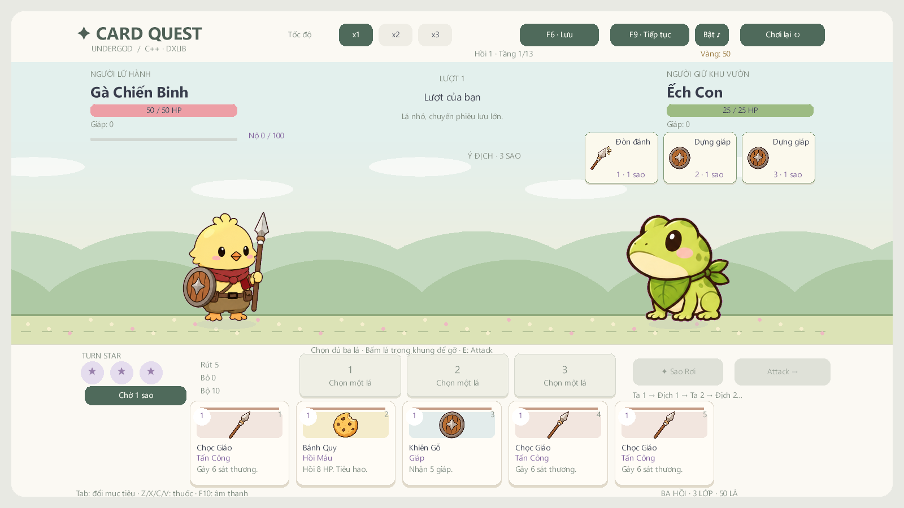
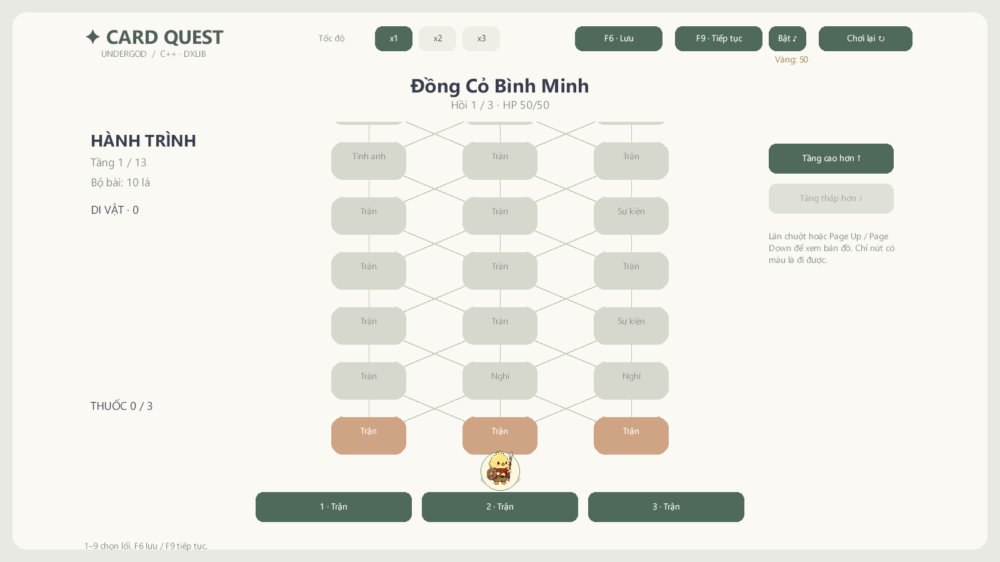

# Kiểm chứng — 2026-11-06

**v1.3.1-preview**, nhánh `draft/v0.3-wip`, C++17 / MSVC v143 / Visual Studio 2022 / DxLib x64. Mốc này đổi cửa sổ và bố cục sang **1600×900, tỉ lệ 16:9**, giữ hoạt ảnh theo kỹ năng, đạn bay và khiên của hai phe. Chi tiết hoạt ảnh ở [SKILL_ANIMATIONS](SKILL_ANIMATIONS.md).

| Kiểm tra | Kết quả |
| --- | --- |
| MSVC Release / Debug x64 | Cả hai build thành công; cảnh báo còn lại C4010 trong SDK DxLib |
| CoreChecks Debug | 4.021 kiểm tra, 0 lỗi |
| CoreChecks Release | 4.021 kiểm tra, 0 lỗi |
| Khung hình/cửa sổ | Backbuffer DxLib và client Win32 đều đo được 1600×900 |
| Bố cục 16:9 | Bài tay 1–10 lá nằm giữa hàng sao và footer; menu/map/shop, mục tiêu và thông báo đã căn lại |
| Hoạt ảnh | 98 cấu hình; 48 lá player chơi được, 36 lá boss, hai lời nguyền, Chờ và 11 hành động địch |
| Art mới | 18 bộ cơ thể + 17 bộ FX, 140 frame khác nhau; không cắt mép, khiên rỗng ở giữa |
| Asset runtime | 379 PNG RGBA8 / 12 WAV; hash, kích thước, tham chiếu và PCM hợp lệ |
| DxLib `--animation-smoke`, `--star-smoke`, `--smoke` | Cả ba `PASS=1`, trên Debug và Release |
| EXE từ ZIP giải nén riêng | Cả ba smoke thoát 0, `PASS=1` |
| Gói | 417 tệp, 18 JSON dữ liệu; CRC, danh sách và hash/EXE khớp nguồn |
| Nội dung đã duyệt | Toàn bộ 379 PNG runtime giữ nguyên hash; HTML nằm ngoài phạm vi chỉnh sửa |

Báo cáo máy đọc và SHA-256 nguồn đã chuẩn hóa xuống dòng LF: [reports/validation.json](reports/validation.json). Mốc trước được giữ tại [v1.3.0](reports/v1.3.0-validation.md), [v1.2.0](reports/v1.2.0-validation.md), [v1.1.0](reports/v1.1.0-validation.md) và [v1.0.1](reports/v1.0.1-validation.md).

Sprite và hiệu ứng giữ cùng tỉ lệ hai chiều, không kéo dãn ảnh 1440×960. Vị trí scene được căn giữa cùng tọa độ bấm chọn mục tiêu; map dùng sáu tầng hiển thị để boss cuối vẫn vào đủ khung khi cuộn hết. Thông báo menu nằm trên tiêu đề, không che nút Bắt đầu.

## Logic và hình ảnh

Kiểm tra thời điểm sát thương thực: lao không gây sát thương trong lúc chuẩn bị, frame đâm và core cùng chạm; Pháp Sư/Cáo đứng niệm, đạn dịch chuyển qua sân rồi mới gây sát thương. Một lá chỉ áp hiệu ứng một lần. Khiên xuất hiện theo giáp thật, còn sau khi lá kết thúc và có nhịp vỡ khi giáp bằng 0. Phản ứng của boss/lính theo đúng đơn vị.

Sao Chép dùng đúng chuyển động/đường bay của lá gốc, giữ ID bài Undergod. Mưa Sao Băng dự đoán đủ sáu mục tiêu bằng bản sao trạng thái; không tiêu RNG thật. X1/X2/X3 kết thúc cùng trạng thái combat và RNG. Đòn kết liễu giữ sân qua phần va chạm, rồi mới mở thưởng; run mới xóa hiệu ứng cũ.

`--animation-smoke` chụp 24 mốc qua renderer/backbuffer DxLib thật và gọi handler chọn bài/Attack: đâm, cầu phép, khiên player, khiên boss, cầu lửa, lao lửa, mưa sao, chém/ném Ninja, lưỡi Ếch và vồ Hổ. Sau đó đi qua binding của 48 lá player và 36 lá boss. Hành vi core của từng lá boss tiếp tục được kiểm tra riêng theo mọi pha.

Đã xem ảnh đạn bay, chạm, khiên giữ, khiên vỡ, lưỡi nối miệng và cú vồ. Lưỡi dùng biên alpha của từng frame để nối đúng miệng; đỉnh cú vồ nằm trong sân. Lá đang thi triển đã chuyển xuống góc phải, không che đường đạn.

35 sheet ImageGen 2×2 xuất 140 PNG RGBA8 512×512. Mỗi bộ có bốn frame khác nhau; body dùng cùng hệ số và chân y=456, FX giữ diễn biến kích thước của ảnh gốc. Prompt/ảnh tham chiếu/hash/QC lưu trong provenance; [báo cáo QC](reports/skill-art-qc.json). Toàn bộ 239 PNG trước đó không bị ghi đè.

## Hồi quy và mô phỏng

Hai smoke cũ tiếp tục kiểm tra map tới đích/giữ xuyên FadeOut, FIGHT/chia bài, thứ tự ba sao, tooltip, bộ riêng của sáu boss, tụ lực, menu, shop/sự kiện, lưu/tải, tuyệt kỹ và thắng hành trình tham chiếu. Không thay luật hoặc chỉ số các lá.

Số liệu mô phỏng tham chiếu từ mốc v1.3.0: 300 seed 0–299, độ khó 0, không mua kỹ năng meta, luân phiên ba lớp; bot chờ hết chuyển cảnh/hành động. Mốc v1.3.1 chỉ sửa renderer/bố cục, không sửa core hoặc dữ liệu combat; đã chạy lại 4.021 kiểm tra core trên mỗi cấu hình, không chạy lại loạt 300 seed.

| Lớp | Run | Thắng | Thua | Kẹt |
| --- | --- | --- | --- | --- |
| Chiến Binh | 100 | 50 | 50 | 0 |
| Pháp Sư | 100 | 28 | 72 | 0 |
| Ninja | 100 | 55 | 45 | 0 |
| Tổng | 300 | 133 | 167 | 0 |

Thua theo hồi: 34/36/97. 90 trận đấu thử Ếch/Hổ: 48 thắng, 42 thua, 0 kẹt; kiểm tra đấu thử không ghi đè tiến trình vẫn qua. Đây là kiểm tra tiến trình và hồi quy, chưa phải tỉ lệ thắng người chơi. [Báo cáo mô phỏng](reports/turn-star-simulation.json).

## Gói Windows

Gói chỉ chứa runtime, dữ liệu, hướng dẫn và giấy phép. Đã so danh sách ZIP chính xác, CRC toàn bộ, hash mọi asset và EXE Release, rồi giải nén vào thư mục riêng chạy cả ba smoke.

- 417 tệp; 56.727.717 byte; 379 PNG / 12 WAV / 18 JSON dữ liệu.
- SHA-256 ZIP: `82c83ff0e924f751a317dfbcb149e4c24c025fba80cb0ab48d673aac3edb518d`.
- SHA-256 EXE: `7ef0f0f10f510a66819bd64553f6c49dae90c38a5f9700f3a008b9c15cc6da0a`.
- [Báo cáo gói](reports/package-validation.json), [hoạt ảnh trong gói](reports/packaged-animation-smoke.txt).

## Giới hạn bằng chứng

Smoke dùng renderer và handler UI thật với fixture có kiểm soát; chưa chơi tay trọn chiến dịch bằng chuột/phím Windows hoặc thử trên máy Windows sạch khác. Thời lượng 25–35 phút/run và tỉ lệ thắng người mới 40–50% cần đo thực tế. Bản phát hành giữ nhãn preview.
