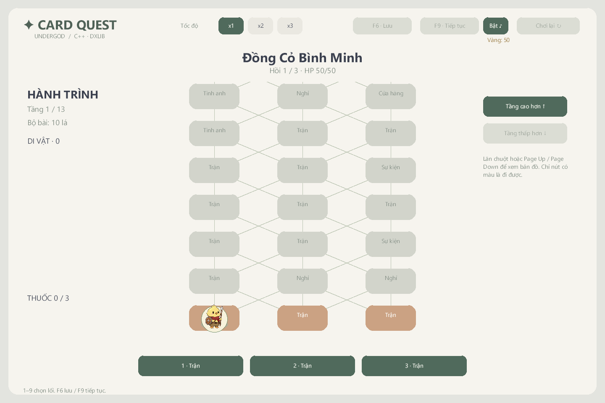
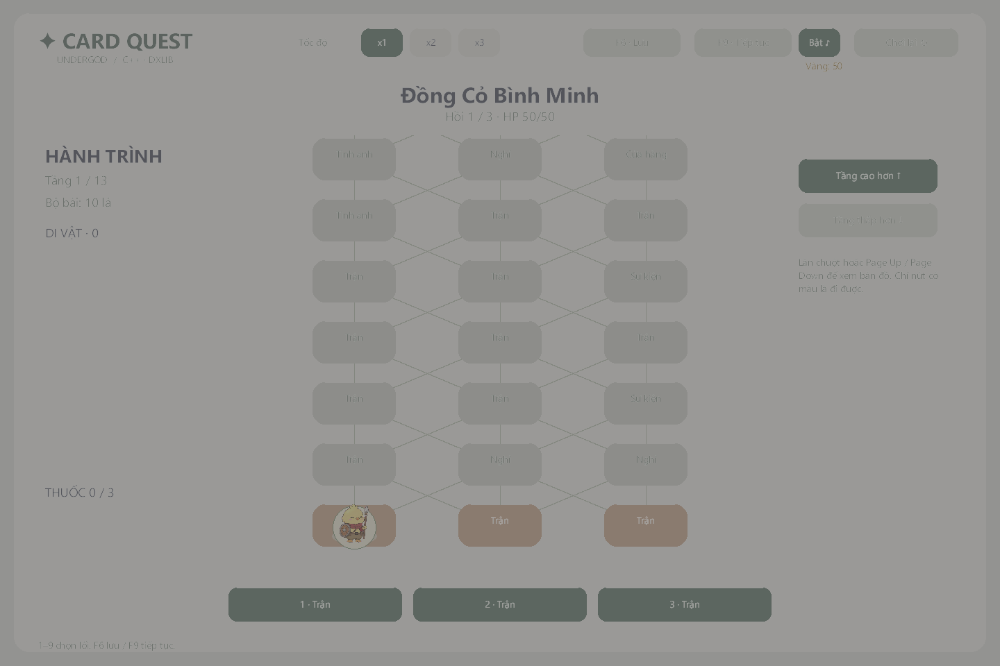
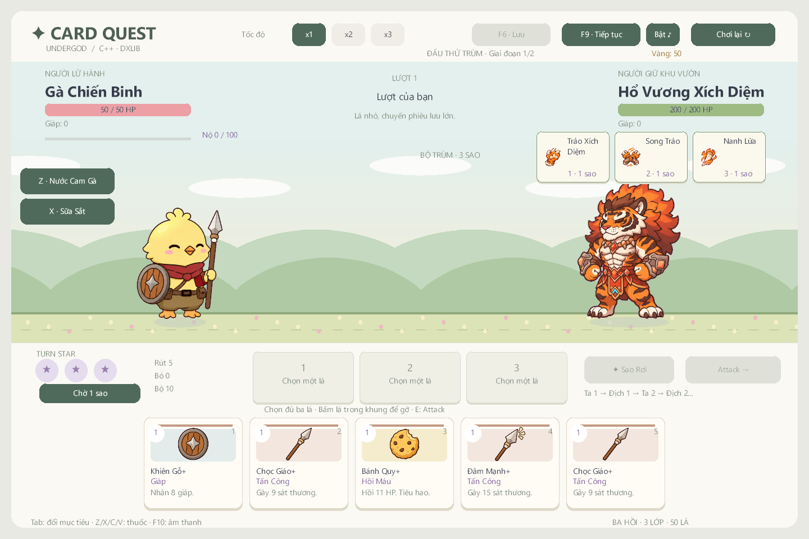

# Kiểm chứng — 2026-11-06

**v1.2.0-preview**, nhánh `draft/v0.3-wip`, C++17 / MSVC v143 / Visual Studio 2022 / DxLib x64. Bản này sửa icon quay về điểm cũ sau khi tới stage và thêm [36 lá riêng của sáu boss](BOSS_DECKS.md). Các sprite/ảnh cũ và demo HTML giữ nguyên hash.

## Kết quả hiện tại

| Kiểm tra | Kết quả |
| --- | --- |
| MSVC Release / Debug x64 | Cả hai build thành công |
| CoreChecks Debug | 3.841 kiểm tra, 0 lỗi |
| CoreChecks Release `--simulate-stars 300` | 3.842 kiểm tra, 0 lỗi; gồm điều kiện chiến dịch không kẹt |
| Bộ boss | Sáu bộ, 36 ID/tên/ảnh/hành động riêng; kiểm tra quyền sở hữu và giới hạn ở mọi pha |
| DxLib `--star-smoke` và `--smoke` | Debug và Release đều `PASS=1` sau lần sửa UI cuối |
| EXE từ ZIP giải nén độc lập | Cả hai smoke thoát 0, `PASS=1` |
| Asset | 239 PNG, 12 WAV; kích thước/hash/tham chiếu/PCM hợp lệ, nạp đủ trong DxLib |
| Gói | Đúng 276 tệp, 17 JSON dữ liệu; CRC/hash/EXE khớp nguồn |
| Giữ nội dung cũ | 203 PNG cũ, 220 tệp runtime HTML và bản HTML một tệp không đổi hash |

Báo cáo máy đọc và hash nguồn: [reports/validation.json](reports/validation.json). Mốc trước ở [v1.1.0](reports/v1.1.0-validation.md), còn luật năng lượng cũ ở [v1.0.1](reports/v1.0.1-validation.md). Không dùng số liệu cân bằng của các mốc cũ để mô tả bộ bài boss mới.

## Icon map và thẻ boss

Lỗi map được tái hiện tại ranh giới Travel → FadeOut: điểm mới chưa xác nhận nên renderer đọc lại `run.node` cũ. Nay icon giữ tọa độ đích trong toàn bộ FadeOut, rồi bàn giao sang điểm đã xác nhận khi màn đen hoàn toàn. Kiểm tra tiếp đường đi sau màn thưởng, lưu/tải và xuất phát từ stage vừa ghé.

`--star-smoke` đo vị trí từ chính helper mà renderer dùng: icon nằm giữa node tại đầu và giữa FadeOut. Đã xem hai ảnh tương ứng; icon không nhảy về lối vào.

Boss rút từ bộ riêng trong `boss_cards.json`, theo pha và trọng số, chốt đủ ba hành động trước Attack. Những lá thường trong một kế hoạch không trùng khi còn lựa chọn; lá giáp hỗ trợ tụ lực được phép lặp. Sáu bộ không nằm trong `config.cards`, shop hay phần thưởng người chơi.

Kiểm tra từng lá: sát thương/nhiều hit, giáp, buff, debuff, gọi viện binh, lời nguyền, hút Nộ, tụ lực hai vòng và Sao Chép. Tụ lực dùng dữ liệu hành động để chọn animation thay vì dựa vào tên ảnh chung cũ. Chuyển pha không thay lá đã công bố. Bản lưu v1.1 được gắn ảnh riêng mà giữ nguyên hành động/RNG; từ chối ID thuộc boss khác hoặc không tồn tại trước khi thay trạng thái.

Đã xem ảnh DxLib của đủ sáu boss, tooltip, tên dài trong khung ba dòng và Hổ tụ lực/vồ. Nhãn đang bay của Diều Hâu nằm dưới hàng bài để không bị che. Hàng ba sao/chia bài/FIGHT tiếp tục hoạt động theo [TURN_STARS](TURN_STARS.md).

Sáu atlas ImageGen 2×3 đã tách thành 36 PNG RGBA8 256×256, alpha/căn giữa cùng tỉ lệ, không chạm mép cell. Prompt/hash nguồn ở `assets/provenance.json` → `boss_card_decks`; ảnh tổng ở [boss-card-icons.png](images/boss-card-icons.png). Không thay 203 PNG đã duyệt trước đó.

## Mô phỏng với bộ boss mới

300 seed 0–299, độ khó 0, không mua kỹ năng meta, luân phiên ba lớp. Bot dùng controller native, chờ hết chuyển cảnh/hành động, tối đa 6.000 quyết định mỗi run.

| Lớp | Run | Thắng | Thua | Kẹt |
| --- | --- | --- | --- | --- |
| Chiến Binh | 100 | 50 | 50 | 0 |
| Pháp Sư | 100 | 28 | 72 | 0 |
| Ninja | 100 | 55 | 45 | 0 |
| Tổng | 300 | 133 | 167 | 0 |

Thua ở hồi 1/2/3: 34/36/97. Đây là bằng chứng kết thúc tiến trình và dữ liệu tham khảo cân bằng, không phải tỉ lệ thắng người chơi. Pháp Sư còn yếu hơn trong chính sách bot hiện tại. Chi tiết ở [turn-star-simulation.json](reports/turn-star-simulation.json).

90 trận đấu thử Ếch/Hổ, seed 0–89, luân phiên ba lớp: 48 thắng, 42 thua, 0 kẹt. Các kiểm tra đấu thử vẫn xác nhận không ghi save/profile hay thưởng meta.

## Gói Windows

ZIP được so danh sách chính xác, hash từng asset, dữ liệu nguồn, EXE Release và CRC toàn bộ. Không chứa save/profile, SDK, PDB hay CoreChecks. Sau giải nén độc lập, đã chạy cả `--star-smoke` và `--smoke`.

- 276 tệp; 37.506.657 byte; 239 PNG, 12 WAV, 17 JSON dữ liệu.
- SHA-256 ZIP: `bf0d7858919ec32ad01810ba25662c53657c8c1ef313aae82bf05e3fdbd41773`.
- SHA-256 EXE: `ef5dc4c39d65ebe4f0012ba181b40be9b82c7fb35f98aa49c72e5d0f1d942962`.
- [Báo cáo gói](reports/package-validation.json), [smoke gói mới](reports/packaged-turn-star-smoke.txt).

## Giới hạn bằng chứng

Smoke dùng renderer/backbuffer DxLib thật và gọi handler UI; không phải bản dựng HTML. Các nhịp chiến đấu dùng fixture có kiểm soát, còn ảnh sáu bộ boss dùng kế hoạch được chọn từ bộ thật. Chưa chơi tay trọn chiến dịch qua chuột/phím Windows hoặc thử trên máy Windows sạch khác.

Thời lượng 25–35 phút/run và tỉ lệ thắng người mới 40–50% vẫn cần đo thực tế; không suy ra từ bot. Bản phát hành giữ nhãn preview. Cảnh báo còn lại là C4010 từ `DxFunctionWin.h` của SDK ngoài repo.
