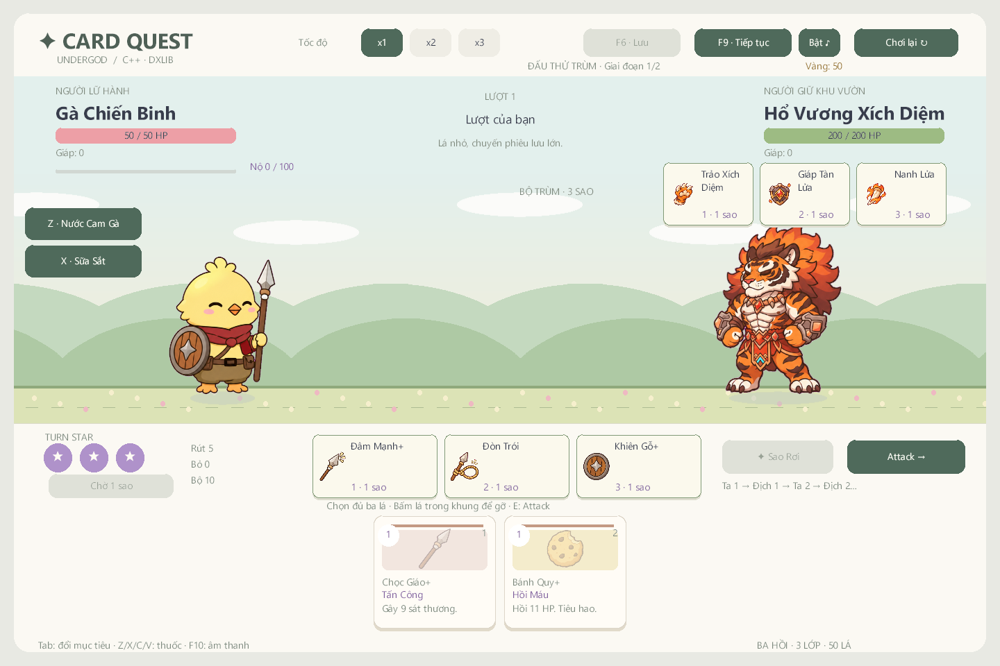
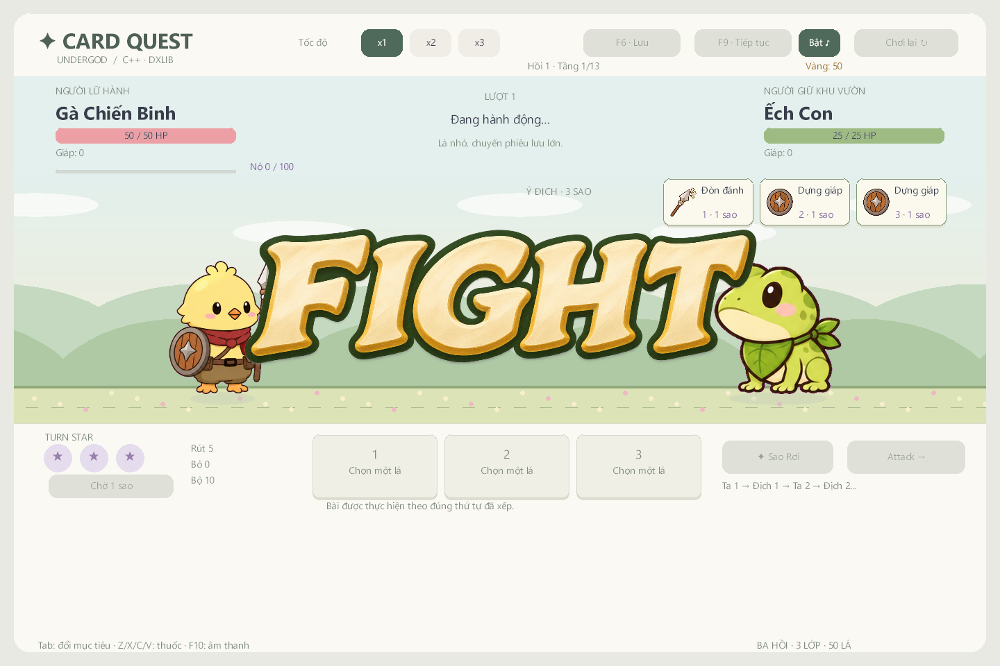

# Kiểm chứng — 2026-11-06

**v1.1.0-preview**, nhánh `draft/v0.3-wip`, C++17 / MSVC v143 / Visual Studio 2022 / DxLib x64. Bản này dùng luật [ba Turn Star](../TURN_STARS.md) trong game native. Demo HTML giữ riêng; đã đối chiếu hash 220 tệp runtime và bản HTML một tệp, tất cả giữ nguyên.

## Kết quả hiện tại

| Kiểm tra | Kết quả |
| --- | --- |
| MSVC Release / Debug x64 | Cả hai build thành công |
| CoreChecks Debug | 3.536 kiểm tra, 0 lỗi |
| CoreChecks Release `--simulate-stars 300` | 3.537 kiểm tra, 0 lỗi; gồm một điều kiện không kẹt cho mô phỏng chiến dịch |
| DxLib `--star-smoke` | Debug và Release đều `PASS=1` |
| DxLib `--smoke` đối chiếu nền cũ | Debug và Release đều `PASS=1` |
| EXE từ ZIP giải nén riêng | Cả `--star-smoke` và `--smoke` thoát 0, `PASS=1` |
| Asset | 203 PNG, 12 WAV; hash, kích thước, tham chiếu, PCM và nạp DxLib hợp lệ |
| ZIP | CRC và danh sách chính xác: 239 tệp, 16 JSON dữ liệu; không chứa save/profile, SDK, PDB hay CoreChecks |

Log và hash nguồn được giữ tại [reports/validation.json](v1.1.0-validation.json). Kết quả v1.0.1 dùng luật năng lượng cũ ở [báo cáo lịch sử](v1.0.1-validation.md); 1.000 run/630 thắng trong báo cáo đó không phải số liệu của luật ba sao.

## Luật mới và trình bày

- Chọn bài chỉ đặt vào hàng chờ, chưa gây sát thương hoặc tiêu hao. Gỡ bài giữ thứ tự, chọn mục tiêu riêng cho từng lá, tối đa ba vị trí. Có Chờ 1 sao để tránh kẹt khi thiếu bài/khóa/lời nguyền.
- Attack khóa thao tác và thực hiện ta 1 → địch 1 → ta 2 → địch 2 → ta 3 → địch 3. Hiệu ứng áp tại nhịp chạm; kiểm tra x1/x2/x3 cho cùng kết quả.
- Địch chốt kế hoạch trước khi chọn bài; hover không đổi RNG. Tooltip dùng hiệu ứng thực, kể cả Sao Chép; chuyển pha giữ kế hoạch đã công bố, tụ lực chỉ tính một lần mỗi vòng.
- Chuyển đổi năng lượng thành rút bài, nâng cấp chỉ giảm giá cũ thành thêm giáp; bài rút trong chuỗi được giữ cho vòng sau. Kiểm tra phản đòn, khóa bài, mục tiêu chết, chuỗi hai trận và tuyệt kỹ kết thúc trận đầu.
- Lưu hàng chờ dở, mục tiêu, kế hoạch địch và RNG; tải session v2 cũ không mất bài. Từ chối bản lưu có hàng chờ trùng hoặc không hợp lệ theo cách giữ nguyên trạng thái đang chơi.
- Avatar di chuyển trước khi vào điểm; xác nhận khu vực chỉ lúc màn hình đen hoàn toàn. FIGHT đi từ phải, dừng giữa, ra trái; sau đó bài mới được chia dần. Khóa thao tác trong các giai đoạn này.

`--star-smoke` gọi handler UI trên renderer DxLib thật, ghi ảnh từ backbuffer. Các tình huống combat dùng fixture có kiểm soát để kiểm tra từng nhịp. Đã xem ảnh map, FIGHT, chia bài, hàng chờ, tụ lực và hổ vồ. Ảnh chọn lọc ở [images](https://github.com/nqxw1kqw/undergod-card/blob/v1.1.0-preview/UndergodCard/docs/images/turn-stars-planning.png).

## Mô phỏng luật ba sao

300 seed 0–299, độ khó 0, không mua kỹ năng meta, luân phiên ba lớp. Bot dùng gợi ý của controller native và chờ mọi chuyển cảnh/hành động; giới hạn 6.000 quyết định mỗi run.

| Lớp | Run | Thắng | Thua | Kẹt |
| --- | --- | --- | --- | --- |
| Chiến Binh | 100 | 37 | 63 | 0 |
| Pháp Sư | 100 | 18 | 82 | 0 |
| Ninja | 100 | 33 | 67 | 0 |
| Tổng | 300 | 88 | 212 | 0 |

Thua ở hồi 1/2/3: 52/73/87. Đây là phép kiểm tra tiến trình và nguồn tham khảo cân bằng; tỉ lệ thắng bot 29,3% không đại diện người chơi. Chênh lệch giữa các lớp, nhất là Pháp Sư, còn cần vòng cân bằng bằng chơi thực. Báo cáo máy đọc: [turn-star-simulation.json](v1.1.0-turn-star-simulation.json).

Thêm 90 trận đấu thử seed 0–89, luân phiên ba lớp và Ếch/Hổ: 47 thắng, 43 thua, 0 kẹt. Đấu thử giữ riêng tiến trình, không ghi save/profile hoặc thưởng meta.

## Gói Windows

`package.ps1 -SkipBuild` đóng gói EXE Release với assets/data/licenses và hướng dẫn UTF-8. `tools/validate_package.py` so CRC, từng hash asset, toàn bộ nội dung nguồn runtime và EXE. Sau đó giải nén sang thư mục kiểm tra độc lập và chạy cả hai chế độ smoke.

- ZIP: 35.596.142 byte; SHA-256 `e64d8703d5b3ee40b3d6d26fc180feb76d96efe7c1432478668b33320a3c8467`.
- EXE: SHA-256 `28b0b346bc0e8d5184ea918a36f689766c45ce6050b04a3d4da73cd46c8bfeb6`.
- Chi tiết: [package-validation.json](v1.1.0-package-validation.json), [smoke gói mới](packaged-turn-star-smoke.txt).

## Giới hạn bằng chứng

Chưa chơi tay trọn chiến dịch qua chuột/phím Windows và chưa thử trên máy Windows sạch khác. Smoke xác minh handler, renderer và audio API; không chứng minh thao tác nhập liệu hệ điều hành. Lỗi helper Computer Use ghi trong báo cáo v1.0.1 là bằng chứng lịch sử, không phải lần thử mới.

Thời lượng 25–35 phút/run và tỉ lệ thắng 40–50% của người mới vẫn cần đo thực tế. Bản phát hành giữ nhãn preview. Cảnh báo C4010 còn lại đến từ `DxFunctionWin.h` của SDK ngoài repo.
